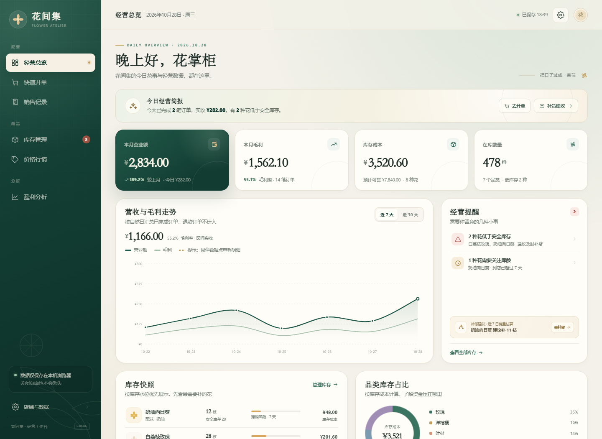

# 花间集 · 花卉经营工作台

一个专门给花店/花艺工作室使用的花卉经营管理应用。既可以作为纯前端单文件离线使用，也可以由 Node 服务端托管，接入云端持久化、多人实时协作、AI 经营助手和工具调用。



## 全栈在线版

```powershell
npm start
```

打开 http://localhost:8787

全栈版新增：

- Node 原生 HTTP 服务，零第三方运行时依赖
- `server/data/state.json` 持久化，页面操作自动同步云端
- `/api/state`、`/api/inventory`、`/api/summary`、`/api/restock` 等 REST API
- **多人实时协作**：同一个链接多人打开即进入同一家店，在线成员、SSE 实时推送、服务端差分合并、同一条数据并发修改冲突提示
- **顾客在线花房 `/shop`**：顾客选花、加入购物袋、填写自提/配送信息、模拟在线支付；支付成功后服务端原子扣库存并生成线上订单，后台实时收到并同步库存
- 实时通道支持降级：本机/直连环境用 SSE；Cloudflare Quick Tunnel 等会缓冲 SSE 的环境自动切换为 2.5 秒轮询，公网体验仍然可用
- 每个浏览器生成独立协作身份，可在右上角头像里修改称呼、查看在线成员、复制邀请链接
- 花掌柜 AI 经营助手：默认接入支持 tools 的免费模型，可调用库存、销售、补货、花卉详情、定价试算 5 个只读工具
- **AI 直达页：`/ai`**，打开页面自动弹出花掌柜 AI，适合直接演示大模型调用
- 375px 手机宽度下无页面横向滚动，库存/销售/盈利/调价表格均有移动卡片替代
- Docker / Render / Procfile 部署配置
- 接口与模型配置详见 **[server/README.md](server/README.md)**

模型默认使用 Pollinations 匿名接口；免费额度约每 45 秒 1 次，超出时会自动使用本地经营规则回答。生产环境可在 `.env` 中配置 `LLM_ENDPOINT`、`LLM_MODEL`、`LLM_API_KEY` 接入自己的模型。

## 多人协作怎么用

1. 用同一个在线地址分别打开两个浏览器（或两个设备）。
2. 右上角头像上会显示当前在线人数，点击头像可以设置自己的称呼、查看在线成员。
3. 任意一方开单、补货、改价、退款或修改资料，另一方页面会自动刷新并提示「某某 调整了库存，已实时同步」。
4. 两个人同时修改同一条数据时，后提交的一方会收到冲突提示，页面自动刷新到最新数据，避免静默覆盖。
5. 如果正在开单或编辑弹窗，会先显示「有新的协作更新」提示，等当前操作结束后再同步，避免打断输入。

> 当前为共享单店协作版，所有加入链接的人默认拥有同一店铺的操作权限；账号登录、角色权限、多门店隔离属于下一步。

## 顾客在线选花与支付

- 顾客入口：`/shop`（后台左侧「渠道 → 线上花店」也可以打开）
- 顾客端只读取花名、品种、颜色、库存、售价等公开信息，不会拿到成本、利润、供应商和后台数据
- 顾客选花后填写收花人、电话、到店自提/同城配送、日期时段和备注
- 结算页选择微信 / 支付宝，进入**演示支付**；演示环境不会产生真实扣款
- 点击确认支付后，服务端校验库存和价格、原子扣减库存、生成订单和库存销售流水
- 订单实时同步到花间集后台：销售记录显示「线上」标签，订单详情显示电话、配送地址、预约时间和「已支付」
- 后台退款该订单会正常恢复库存，并联动营收和毛利统计

> 支付目前是演示流程，没有接入微信/支付宝商户号。正式上线需要增加支付网关、回调验签、订单幂等和退款接口。


## 离线单文件版

1. 用 Chrome、Edge 或其他现代浏览器打开 `index.html`。
2. 首次打开会载入 8 种示例花卉、18 笔订单和调价记录，方便直接体验所有功能。
3. 在左下角「店铺与数据」里可以修改店名、清空示例数据或导入/导出备份。

> 离线版数据保存在当前浏览器的 localStorage 中，关闭页面不会丢失，但不会跨设备同步。清理浏览器数据前请先导出备份。

## 分享给他人

- **手机直接打开**：发送 `exports/花间集-手机版.html`，在手机浏览器中打开即可；已适配底部导航、卡片式库存和移动开单。
- **只想让对方直接看电脑版**：发送 `exports/花间集-花卉经营管理-单文件版.html`，对方双击即可打开，无需解压，也无需联网。
- **想附带源码和说明**：发送 `exports/花间集-花卉经营管理.zip`，解压后双击里面的 `index.html`。
- 对方首次打开会看到示例数据；如需分享自己的真实经营数据，请先在「店铺与数据」中导出 JSON 备份，再单独发送备份文件。

## 功能清单

### 经营总览
- 本月营业额、本月毛利、库存成本、在库数量
- 近 7 天 / 30 天营收与毛利趋势图
- 今日经营简报、低库存提醒、滞销提醒、毛利偏薄提醒
- 补货建议、库存快照、品类库存占比

### 库存管理
- 新增花卉、编辑资料、删除花卉
- 花名、品种、供应商、位置搜索
- 按品类、低库存、库龄、售罄等状态筛选
- 剩余数量、单价、成本、毛利率、库龄一屏查看
- 手动库存变更：
  - 补货入库（按加权平均自动更新成本）
  - 损耗出库（计入损耗成本）
  - 盘点修正（盘盈 / 盘亏）
- 每次变更生成可回溯的库存流水

### 快速开单
- 多商品购物清单
- 现场修改数量和单价
- 客户、收款方式、开单日期、备注
- 自动扣减库存、计算毛利、生成订单号
- 完成收款后弹出销售凭证
- 移动端提供底部清单快捷条

### 销售记录
- 按时间、收款方式、关键词筛选
- 查看商品明细、成本、毛利、备注
- 整单退款：自动恢复库存、剔除营收与毛利
- 导出 CSV 销售明细

### 价格行情
- 当前售价、单位成本、毛利率、近 30 天调价次数
- 售价 / 成本走势图（ zoom 到有意义的区间，便于观察价格浮动）
- 按售价与目标毛利率倒推建议售价
- 完整调价记录：原价、新价、涨跌幅、成本变化、原因

### 盈利分析
- 营业收入、商品成本、毛利、净利润
- 损耗成本与损耗率
- 近 14 天营收 / 毛利趋势
- 品类收入结构
- 花卉盈利能力排行
- 客户贡献排行
- 自动经营诊断

## 数据与备份

- 自动保存：所有修改即时写入浏览器本地存储，并同步到服务端。
- 多端同步：服务端按业务对象做差分合并；同一条数据的并发修改会提示冲突，不会静默覆盖。
- 完整备份：店铺与数据 → 导出完整备份（`.json`）。
- 导入恢复：选择之前导出的 JSON 备份文件。
- 表格导出：库存与销售明细可导出带 BOM 的 CSV，Excel 直接打开不乱码。
- 快捷键：`Ctrl/Cmd + K` 跳转到库存搜索；`Esc` 关闭弹窗或侧边栏。

## 文件结构

```text
flower-manager/
├─ index.html   页面框架与导航
├─ styles.css   视觉样式与响应式布局
├─ data.js      数据模型、演示数据、业务计算、协作同步与本地存储
├─ views.js     各页面视图与 SVG 图表
├─ app.js       交互、表单、弹窗、导入导出
├─ assistant.js / assistant.css  花掌柜 AI 助手
├─ collab.js / collab.css        多人协作、在线成员与实时同步
├─ shop.html / shop.css / shop.js 顾客在线花房与演示支付
├─ server/      Node 服务端、API、模型、SSE 与数据持久化
├─ preview.png  界面预览
└─ README.md
```

## 说明

- 离线单文件版无外部依赖、无网络请求，打开即用。
- 全栈版通过 SSE 保持多人实时同步，Cloudflare / Render 等平台均可运行。
- 采用响应式布局，桌面、平板和手机均可使用；已在 375px 宽度检查所有主页面与弹窗。
- 示例数据中的日期和金额均以打开页面的时间为基准生成，可随时在「店铺与数据」中恢复或清空。
