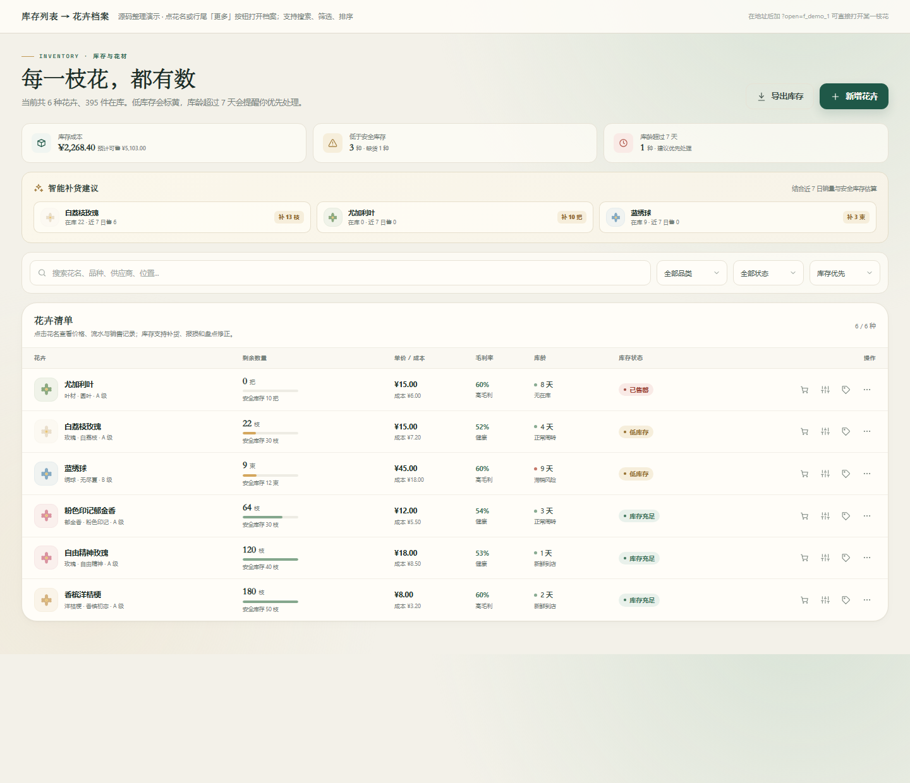
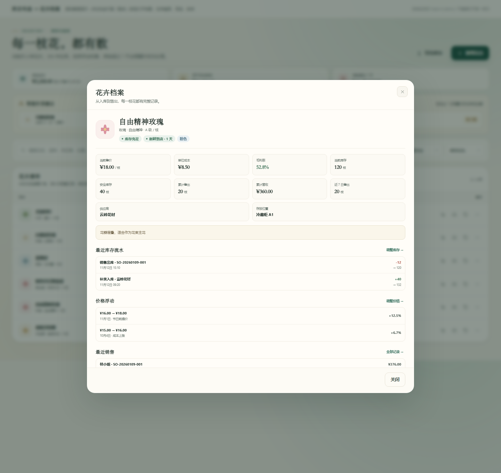
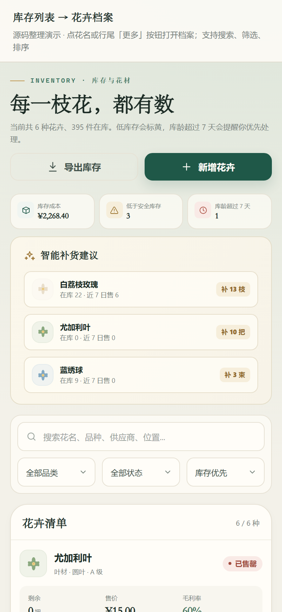
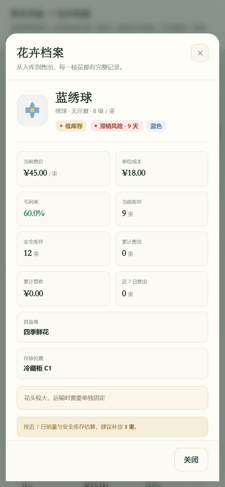

# 库存列表 → 花卉档案：源码整理

> **项目**：花间集 · 花卉经营工作台（`flower-manager`）
> **本册整理的功能**：库存管理**列表页**，以及点开花名后弹出的**「花卉档案」详情页**
> **原始文件**：`index.html` · `views.js` · `app.js` · `data.js` · `styles.css`
> **整理方式**：按行号原样摘出，不改逻辑、不重写；只补了拆文件后必须的几行声明（已在各文件头部注明）

---

## 0. 先看效果

**列表页**（桌面 1440px）：统计卡 → 智能补货 → 筛选栏 → 花卉清单。花名、行尾「更多」按钮、手机卡片上的「详情」都是同一个人口。



**详情页**（同一份数据，点「自由精神玫瑰」后）：身份信息 → 8 个关键数字 → 补货建议 → 最近库存流水 / 价格浮动 / 最近销售 → 底部操作。



手机 390px 下不横向滚动，表格自动换成卡片，详情弹窗在 88vh 内滚动：

| 列表（手机） | 详情（手机） |
| --- | --- |
|  |  |

---

## 1. 一分钟看懂这条链路

```
用户点击
  <button data-action="view-flower" data-id="f_demo_1">自由精神玫瑰</button>
        │
        │  document 上只挂了一个 click 监听（事件委托）
        ▼
handleClick(event) → switch (target.dataset.action)
        │  case 'view-flower'
        ▼
openFlowerDetail('f_demo_1')
        ├─ 取数据   getFlower(id)、state.orders / movements / priceHistory
        ├─ 算指标   stockStatus / freshness / marginState / restockSuggestion
        ├─ 拼 HTML  detail-hero + detail-grid + 3 × detail-section + detail-actions
        └─ openModal({ title: '花卉档案', size: 'large' })
                 └─ modal.innerHTML = head + body + foot
                    layer.hidden = false；body.modal-open；记住 lastFocused
```

关闭时反过来：遮罩、右上角 ×、底部「关闭」、`Esc` 都只是调用 `closeModal()`，它负责隐藏、清空、解除滚动锁、把焦点还给原来那个按钮。

| 层 | 函数 / 代码 | 位置 | 职责 |
| --- | --- | --- | --- |
| 数据 | `state.flowers` / `orders` / `movements` / `priceHistory` | `data.js` | 唯一的真相来源 |
| 计算 | `stockStatus` `freshness` `marginState` `restockSuggestion` `inventorySummary` | `data.js:807-898` | 只读 state，返回纯对象 |
| 列表视图 | `renderInventoryView` / `inventoryTableInner` / `filteredFlowers` | `views.js:532-742` | 拼列表页 HTML 字符串 |
| 详情视图 | `openFlowerDetail` | `app.js:925-1032` | 拼档案 HTML 字符串并弹窗 |
| 弹窗底座 | `openModal` / `closeModal` | `app.js:261-281`、`336-351` | 打开、关闭、焦点与滚动锁 |
| 事件 | `handleClick` 等 | `app.js:1461-1595` | `data-action` 分发到具体函数 |
| 样式 | `.table-card` `.detail-*` `.modal` | `styles.css` | 桌面 / 手机两套布局 |

**没有框架、没有虚拟 DOM**：一次渲染就是 `element.innerHTML = 一段模板字符串`。所以整个功能可以拆成「算数据 → 拼字符串 → 塞进 DOM → 事件委托」四步来看。

---

## 2. 本册目录

```
docs/库存列表与花卉档案/
├─ README.md                 ← 本文件：讲解 + 完整源码
├─ demo/
│  ├─ index.html             ← 双击即可运行（复用主项目 styles.css）
│  └─ demo.js                ← 只提供演示数据与占位函数
├─ src/
│  ├─ 1-数据与计算.js         ← data.js 摘录
│  ├─ 2-列表页.js             ← views.js 摘录
│  ├─ 3-详情页.js             ← app.js 摘录
│  ├─ 4-弹窗底座.js           ← app.js 摘录
│  └─ 5-事件入口.js           ← app.js 摘录（保留相关分支）
└─ shots/                    ← 截图
```

`src/` 下的五个文件可以在同一页面里按顺序加载并直接工作——`demo/index.html` 就是这么做的，顺序与主项目 `index.html` 一致。

---

## 3. 列表页

### 3.1 页面骨架：先分区，再交给子函数

`renderInventoryView()` 只负责**版面顺序**：页头 → 三张统计卡 → 智能补货 → 筛选栏 → 表格卡片。表格部分单独抽成 `inventoryTableInner()`，塞进 `#inventoryTableWrap`。

这个拆分不是为了好看，是为了**局部刷新**：用户每敲一个字，如果整页重渲染，输入框会被替换、光标丢失。所以搜索走 `refreshInventoryTable()`，只替换 `#inventoryTableWrap.innerHTML`，输入框原地不动：

```js
function refreshInventoryTable() {
  const wrap = document.getElementById('inventoryTableWrap');
  if (!wrap) return;
  wrap.innerHTML = inventoryTableInner();
  const active = activeFlowers().length;
  const count = document.getElementById('inventoryCount');
  if (count) count.textContent = `${filteredFlowers().length} / ${active} 种`;
  toggleClearButton('inventory', Boolean(ui.invSearch));
}
```

而品类 / 状态 / 排序是 `<select>` 的 `change`，焦点不在输入框，直接 `render()` 整页重建，代码更省。

### 3.2 筛选排序：filteredFlowers

```text
let list = activeFlowers();          // 过滤掉下架的花
search  → 模糊匹配 花名/品种/品类/颜色/供应商/货位/备注
invCategory → 精确匹配
invStatus   → low / healthy / slow / empty 四种状态
invSort     → 默认按"库存健康度"升序（最该补的排最前）
```

排序的默认值 `stockPercent(a) - stockPercent(b)` 是个小设计：库存越接近见底越靠前，店长打开页面第一眼看到的就是该补的货。

### 3.3 同一份数据，两份 DOM

`inventoryTableInner()` 一次返回两块结构：

* 桌面：`.table-wrap.desktop-table-only` 里的 `<table class="data-table">`
* 手机：`.mobile-flower-list.mobile-only` 里的一串 `<article class="mobile-flower-card">`

切换**不靠 JavaScript 判断屏幕宽度**，而是靠 CSS。整个项目里没有任何 `innerWidth` / `matchMedia` 调用；断点位于 `styles.css:2367` 的 `@media (max-width: 900px)`，同一块里还一起打开了底部标签栏和安全区内边距：

```css
.mobile-only { display: none; }                  /* styles.css:2209 */
.mobile-flower-list { display: none; }           /* styles.css:2212 */

@media (max-width: 900px) {                      /* styles.css:2367 */
  .mobile-only { display: block; }               /* styles.css:2431 */
  .mobile-flower-list { display: flex; }         /* styles.css:2432 */
  .desktop-table-only { display: none !important; }  /* styles.css:2436 */
}
```

好处是服务端 / 离线单文件版都能用、没有 JS 抖动；代价是同一份数据要写两遍模板，字段增减时两处都要改。

为什么不用 JS 量宽度：① 离线单文件版和手机版都是静态 HTML，首帧就要是正确的，不能等脚本跑完再切（否则会看到表格闪一下变卡片）；② 断点只写一处，不用同时维护 JS 阈值和 CSS 阈值；③ 不监听 `resize`，就没有重建 DOM、没有输入被吞，浏览器缩放、分屏、平板旋转都是即时生效。

### 3.4 每行动作都用 data-action + data-id

```html
<button class="flower-name" data-action="view-flower" data-id="f_demo_1">自由精神玫瑰</button>
...
<button class="table-btn" data-action="quick-sale"  data-id="f_demo_1">…</button>
<button class="table-btn" data-action="adjust-stock" data-id="f_demo_1">…</button>
<button class="table-btn" data-action="change-price" data-id="f_demo_1">…</button>
<button class="table-btn" data-action="view-flower"   data-id="f_demo_1">…</button>
```

页面里没有 `addEventListener` 绑定到行上，全部由第 7 节的一个 `document` 监听接住。

### 3.5 完整源码

```js
/* =========================================================
   花间集 · 库存列表 → 花卉档案（源码整理）
   文件 2 / 5：列表页（库存管理）
   摘录自：views.js（原样摘录，未改动逻辑）
     · 第 6-25 行     VIEW_META 与 renderView 路由
     · 第 28-46 行    通用组件：页头、空状态
     · 第 69-72 行    库存徽标
     · 第 532-742 行  筛选排序、表格 / 移动卡片、整页渲染
   依赖：1-数据与计算.js、state、ui
   ========================================================= */

/* ---------- views.js:6-25  页面路由 ---------- */
const VIEW_META = {
  dashboard: { kicker: '经营总览', title: '今天，花事如何？' },
  inventory: { kicker: '库存管理', title: '每一枝花，都有数' },
  sales: { kicker: '快速开单', title: '把花，交给对的人' },
  records: { kicker: '销售记录', title: '每一笔，都记得' },
  finance: { kicker: '盈利分析', title: '看见花开的回报' },
  pricing: { kicker: '价格行情', title: '定价，也是一门花艺' }
};

function renderView(view) {
  switch (view) {
    case 'inventory': return renderInventoryView();
    case 'sales': return renderSalesView();
    case 'records': return renderRecordsView();
    case 'finance': return renderFinanceView();
    case 'pricing': return renderPricingView();
    case 'dashboard':
    default: return renderDashboardView();
  }
}

/* ---------- views.js:28-46  通用组件：页头与空状态 ---------- */
function pageHeadHTML({ eyebrow, title, description, actions = '' }) {
  return `<div class="page-head">
    <div class="page-head-copy">
      <div class="eyebrow">${escapeHTML(eyebrow)}</div>
      <h1>${escapeHTML(title)}</h1>
      <p>${description}</p>
    </div>
    ${actions ? `<div class="page-actions">${actions}</div>` : ''}
  </div>`;
}

function emptyStateHTML({ title, description, action = '', iconName = 'flower' }) {
  return `<div class="empty-state">
    <div class="empty-illustration">${icon(iconName, 46)}</div>
    <h3>${escapeHTML(title)}</h3>
    <p>${escapeHTML(description)}</p>
    ${action}
  </div>`;
}

/* ---------- views.js:69-72  库存徽标 ---------- */
function badgeForStock(flower) {
  const s = stockStatus(flower);
  return `<span class="badge ${s.badge}">${s.label}</span>`;
}

/* ---------- views.js:532-742  库存列表：筛选、表格、移动卡片与整页渲染 ---------- */
function filteredFlowers() {
  let list = activeFlowers();
  const search = ui.invSearch.trim().toLowerCase();
  if (search) {
    list = list.filter((f) => [f.name, f.variety, f.category, f.color, f.supplier, f.location, f.note]
      .join(' ').toLowerCase().includes(search));
  }
  if (ui.invCategory !== 'all') list = list.filter((f) => f.category === ui.invCategory);
  if (ui.invStatus === 'low') list = list.filter((f) => f.stock <= f.minStock);
  else if (ui.invStatus === 'healthy') list = list.filter((f) => f.stock > f.minStock);
  else if (ui.invStatus === 'slow') list = list.filter((f) => f.stock > 0 && shelfDays(f) >= 7);
  else if (ui.invStatus === 'empty') list = list.filter((f) => f.stock <= 0);

  switch (ui.invSort) {
    case 'stockAsc': list.sort((a, b) => a.stock - b.stock); break;
    case 'stockDesc': list.sort((a, b) => b.stock - a.stock); break;
    case 'priceDesc': list.sort((a, b) => b.price - a.price); break;
    case 'marginAsc': list.sort((a, b) => grossMargin(a.price, a.cost) - grossMargin(b.price, b.cost)); break;
    case 'newest': list.sort((a, b) => new Date(b.createdAt) - new Date(a.createdAt)); break;
    case 'name': list.sort((a, b) => a.name.localeCompare(b.name, 'zh-CN')); break;
    default: list.sort((a, b) => stockPercent(a) - stockPercent(b));
  }
  return list;
}

function inventoryTableInner() {
  const list = filteredFlowers();
  if (!list.length) {
    return emptyStateHTML({
      title: '没有找到匹配的花卉',
      description: '换个关键词或筛选条件试试，也可以新增一种花。',
      action: '<button class="btn btn-primary btn-sm" data-action="open-add-flower">新增花卉</button>'
    });
  }
  const rows = list.map((flower) => {
    const status = stockStatus(flower);
    const fresh = freshness(flower);
    const margin = marginState(flower.price, flower.cost);
    return `<tr>
      <td>
        <div class="flower-cell">
          ${flowerAvatar(flower)}
          <div class="flower-cell-copy">
            <button class="flower-name" data-action="view-flower" data-id="${flower.id}" title="查看 ${escapeHTML(flower.name)} 档案">${escapeHTML(flower.name)}</button>
            <span class="flower-meta">${escapeHTML(flower.category)} · ${escapeHTML(flower.variety || flower.color || '常规')} · ${escapeHTML(flower.grade)} 级</span>
          </div>
        </div>
      </td>
      <td>
        <div class="stock-cell">
          <div class="stock-cell-top"><strong>${number(flower.stock)}</strong><span>${escapeHTML(flower.unit)}</span></div>
          <div class="stock-bar"><i class="${status.bar}" style="width:${stockPercent(flower)}%"></i></div>
          <span class="stock-min">安全库存 ${number(flower.minStock)} ${escapeHTML(flower.unit)}</span>
        </div>
      </td>
      <td class="price-cell">
        <strong>${money(flower.price)}</strong>
        <span>成本 ${money(flower.cost)}</span>
      </td>
      <td>
        <span class="margin-text ${margin.tone}">${percent(margin.margin, 0)}</span>
        <span class="flower-meta">${margin.label}</span>
      </td>
      <td class="age-cell">
        <span class="age-main"><i class="age-dot ${fresh.tone === 'bad' ? 'bad' : fresh.tone === 'warn' ? 'warn' : ''}"></i>${fresh.days} 天</span>
        <span class="age-sub">${fresh.label}</span>
      </td>
      <td class="status-cell">${badgeForStock(flower)}</td>
      <td>
        <div class="row-actions">
          <button class="table-btn" data-action="quick-sale" data-id="${flower.id}" title="加入开单" aria-label="加入开单">${icon('cart', 14)}</button>
          <button class="table-btn" data-action="adjust-stock" data-id="${flower.id}" title="调整库存" aria-label="调整库存">${icon('sliders', 14)}</button>
          <button class="table-btn" data-action="change-price" data-id="${flower.id}" title="调整售价" aria-label="调整售价">${icon('tag', 14)}</button>
          <button class="table-btn" data-action="view-flower" data-id="${flower.id}" title="查看档案" aria-label="查看档案">${icon('more', 14)}</button>
        </div>
      </td>
    </tr>`;
  }).join('');

  const mobileCards = list.map((flower) => {
    const status = stockStatus(flower);
    const fresh = freshness(flower);
    const margin = marginState(flower.price, flower.cost);
    return `<article class="mobile-flower-card">
      <div class="mfc-head">
        ${flowerAvatar(flower)}
        <div class="mfc-title">
          <button class="mfc-name" data-action="view-flower" data-id="${flower.id}">${escapeHTML(flower.name)}</button>
          <span class="flower-meta">${escapeHTML(flower.category)} · ${escapeHTML(flower.variety || flower.color || '常规')} · ${escapeHTML(flower.grade)} 级</span>
        </div>
        ${badgeForStock(flower)}
      </div>
      <div class="mfc-stats">
        <div class="mfc-stat"><span>剩余</span><strong>${number(flower.stock)}<small>${escapeHTML(flower.unit)}</small></strong></div>
        <div class="mfc-stat"><span>售价</span><strong>${money(flower.price)}</strong><small>成本 ${money(flower.cost)}</small></div>
        <div class="mfc-stat"><span>毛利率</span><strong class="margin-text ${margin.tone}">${percent(margin.margin, 0)}</strong><small>${margin.label}</small></div>
      </div>
      <div class="mfc-stock">
        <span class="stock-bar"><i class="${status.bar}" style="width:${stockPercent(flower)}%"></i></span>
        <span>安全库存 ${number(flower.minStock)} · 库龄 ${fresh.days} 天 · ${fresh.label}</span>
      </div>
      <div class="mfc-actions">
        <button class="mfc-action is-primary" data-action="quick-sale" data-id="${flower.id}">${icon('cart', 13)} 开单</button>
        <button class="mfc-action" data-action="adjust-stock" data-id="${flower.id}">${icon('box', 13)} 补货</button>
        <button class="mfc-action" data-action="change-price" data-id="${flower.id}">${icon('tag', 13)} 调价</button>
        <button class="mfc-action" data-action="view-flower" data-id="${flower.id}">${icon('more', 13)} 详情</button>
      </div>
    </article>`;
  }).join('');

  return `<div class="mobile-flower-list mobile-only">${mobileCards}</div>
  <div class="table-wrap desktop-table-only">
    <table class="data-table">
      <thead><tr>
        <th>花卉</th><th>剩余数量</th><th>单价 / 成本</th><th>毛利率</th><th>库龄</th><th>库存状态</th><th style="text-align:right">操作</th>
      </tr></thead>
      <tbody>${rows}</tbody>
    </table>
  </div>`;
}

function renderInventoryView() {
  const summary = inventorySummary();
  const all = activeFlowers();
  const categories = Array.from(new Set([...CATEGORIES, ...all.map((f) => f.category)]));
  const suggestions = replenishmentList(3);
  const filtersActive = ui.invSearch || ui.invCategory !== 'all' || ui.invStatus !== 'all';

  const suggestionHTML = suggestions.length ? `<section class="restock-panel">
    <div class="restock-head">
      <h3>${icon('sparkles', 16)} 智能补货建议</h3>
      <span>结合近 7 日销量与安全库存估算</span>
    </div>
    <div class="restock-list">
      ${suggestions.map(({ flower, plan }) => `<button class="restock-item" data-action="adjust-stock" data-id="${flower.id}">
        ${flowerAvatar(flower)}
        <span class="restock-copy">
          <strong>${escapeHTML(flower.name)}</strong>
          <small>在库 ${number(flower.stock)} · 近 7 日售 ${number(plan.sold)}</small>
        </span>
        <span class="restock-badge">补 ${number(plan.suggested)} ${escapeHTML(flower.unit)}</span>
      </button>`).join('')}
    </div>
  </section>` : '';

  return `
    ${pageHeadHTML({
      eyebrow: 'INVENTORY · 库存与花材',
      title: VIEW_META.inventory.title,
      description: `当前共 ${summary.sku} 种花卉、${number(summary.units)} 件在库。低库存会标黄，库龄超过 7 天会提醒你优先处理。`,
      actions: `<button class="btn btn-ghost" data-action="export-inventory-csv">${icon('download', 16)} 导出库存</button>
        <button class="btn btn-primary" data-action="open-add-flower">${icon('plus', 16)} 新增花卉</button>`
    })}

    <div class="inventory-stats">
      <div class="inv-stat">
        <span class="inv-stat-icon">${icon('box', 15)}</span>
        <span class="inv-stat-copy"><span>库存成本</span><strong>${money(summary.costValue)} <small>预计可售 ${money(summary.retailValue)}</small></strong></span>
      </div>
      <div class="inv-stat">
        <span class="inv-stat-icon is-gold">${icon('alert', 15)}</span>
        <span class="inv-stat-copy"><span>低于安全库存</span><strong>${summary.lowCount} <small>种 · 缺货 ${summary.emptyCount} 种</small></strong></span>
      </div>
      <div class="inv-stat">
        <span class="inv-stat-icon is-red">${icon('clock', 15)}</span>
        <span class="inv-stat-copy"><span>库龄超过 7 天</span><strong>${summary.slowCount} <small>种 · 建议优先处理</small></strong></span>
      </div>
    </div>

    ${suggestionHTML}

    <div class="filter-bar">
      <div class="search-box">
        ${icon('search', 15)}
        <input id="invSearch" type="search" value="${escapeHTML(ui.invSearch)}" placeholder="搜索花名、品种、供应商、位置..." autocomplete="off" aria-label="搜索库存">
        <button class="search-clear" data-action="clear-search" data-target="inventory" aria-label="清空搜索" ${ui.invSearch ? '' : 'hidden'}>${icon('x', 12)}</button>
      </div>
      <select class="select" id="invCategory" aria-label="筛选品类">
        <option value="all">全部品类</option>
        ${categories.map((cat) => `<option value="${escapeHTML(cat)}" ${ui.invCategory === cat ? 'selected' : ''}>${escapeHTML(cat)}</option>`).join('')}
      </select>
      <select class="select" id="invStatus" aria-label="筛选库存状态">
        <option value="all" ${ui.invStatus === 'all' ? 'selected' : ''}>全部状态</option>
        <option value="low" ${ui.invStatus === 'low' ? 'selected' : ''}>低库存 / 缺货</option>
        <option value="healthy" ${ui.invStatus === 'healthy' ? 'selected' : ''}>库存健康</option>
        <option value="slow" ${ui.invStatus === 'slow' ? 'selected' : ''}>库龄超 7 天</option>
        <option value="empty" ${ui.invStatus === 'empty' ? 'selected' : ''}>已售罄</option>
      </select>
      <select class="select" id="invSort" aria-label="排序方式">
        <option value="default" ${ui.invSort === 'default' ? 'selected' : ''}>库存优先</option>
        <option value="stockAsc" ${ui.invSort === 'stockAsc' ? 'selected' : ''}>库存少 → 多</option>
        <option value="stockDesc" ${ui.invSort === 'stockDesc' ? 'selected' : ''}>库存多 → 少</option>
        <option value="priceDesc" ${ui.invSort === 'priceDesc' ? 'selected' : ''}>售价高 → 低</option>
        <option value="marginAsc" ${ui.invSort === 'marginAsc' ? 'selected' : ''}>毛利低 → 高</option>
        <option value="newest" ${ui.invSort === 'newest' ? 'selected' : ''}>最近建档</option>
        <option value="name" ${ui.invSort === 'name' ? 'selected' : ''}>名称排序</option>
      </select>
      ${filtersActive ? `<button class="btn btn-ghost btn-sm" data-action="reset-inventory-filters">重置</button>` : ''}
    </div>

    <section class="card table-card">
      <div class="table-card-head">
        <div>
          <h2>花卉清单</h2>
          <p>点击花名查看价格、流水与销售记录；库存支持补货、报损和盘点修正。</p>
        </div>
        <span class="count-chip" id="inventoryCount">${filteredFlowers().length} / ${all.length} 种</span>
      </div>
      <div id="inventoryTableWrap">${inventoryTableInner()}</div>
    </section>`;
}

/* ---------- views.js:1282-1287  价格变动查询（详情页「价格浮动」一节使用） ---------- */
/* ---------------- 价格行情 ---------------- */
function priceHistoryForFlower(flowerId) {
  return state.priceHistory
    .filter((p) => p.flowerId === flowerId)
    .sort((a, b) => new Date(b.date) - new Date(a.date));
}
```

---

## 4. 详情页

### 4.1 打开时先把数算完

`openFlowerDetail(id)` 进门先取花，再一次性算齐所有要展示的东西，然后才开始拼字符串：

| 变量 | 来源 | 用途 |
| --- | --- | --- |
| `status` | `stockStatus(flower)` | 已售罄 / 低库存 / 库存偏低 / 库存充足 |
| `fresh` | `freshness(flower)` | 新鲜到店 / 正常周转 / 需要关注 / 滞销风险 |
| `margin` | `marginState(price, cost)` | 52.8% + 高毛利 / 健康 / 偏低 / 过薄 |
| `plan` | `restockSuggestion(flower)` | 近 7 日售出、建议补货量、可售天数 |
| `movements` | `state.movements` 过滤本花，按时间倒序取 4 条 | 最近库存流水 |
| `prices` | `priceHistoryForFlower(id)` 取 3 条 | 价格浮动 |
| `relatedOrders` | `state.orders` 里含本花的，取 3 条 | 最近销售 |
| `totalUnits` / `totalRevenue` | 遍历 `completed` 订单累加 | 累计售出、累计营收 |

这带来一个好处：**HTML 里没有任何计算**，只有插值。也带来一个限制：详情是"打开那一刻的快照"，数据变了要重新打开才会更新（协作冲突时直接关掉弹窗刷新数据，见 `__collabOnConflict`）。

### 4.2 版块顺序是按"看档案的人想问什么"排的

1. `detail-hero`：花名、品类/品种/等级/单位、三个徽标（库存状态、库龄、颜色）
2. `detail-grid`：8 个数字 + 2 个宽块（供应商、货位）
3. 备注 + 补货建议（`price-health.is-warn` 黄色条）
4. 最近库存流水 → 价格浮动 → 最近销售，三节都带一个"跳去做这件事"的入口
5. `detail-actions`：加入开单 / 调整库存 / 调整价格 / 编辑资料 / 删除

### 4.3 详情页自己没有事件监听

底部五个按钮、以及三个小节右侧的「调整库存 →」「调整价格 →」「全部记录 →」仍然是 `data-action`：

```html
<button data-action="adjust-stock" data-id="…">调整库存 →</button>
<button data-action="nav" data-view="records">全部记录 →</button>
```

所以点详情里的「调整库存」，不会另开一套逻辑，而是和列表里那个按钮走同一个 `case 'adjust-stock'`。**新增动作只需要在两处出现：按钮上的 `data-action`，和 `handleClick` 里的一个 `case`。**

### 4.4 弹窗尺寸

`openModal({ size: 'large' })` → `.modal.is-large { width: min(940px, 100%); }`，高度 `min(88vh, 900px)`，正文区 `overflow-y: auto`，所以手机上是一张可滚动的长卡片，底部按钮始终固定。

### 4.5 一个真实的小瑕疵

`app.js` 写销售流水时，`note` 已经带了动作词：

```js
state.movements.unshift({ type: 'sale', note: `销售出库 · ${order.no}` });
```

而详情里又拼了一次：

```js
`${stockMovementLabel(movement.type)}${movement.note ? ` · ${escapeHTML(movement.note)}` : ''}`
```

于是显示成「销售出库 · 销售出库 · SO-20260109-001」。修法二选一：把 `app.js` 里的 `note` 改成只存 `order.no`（演示数据就是这么写的），或者详情里只显示 `note`、不再拼 `stockMovementLabel`。种子数据的 note 是「常规补货」这类纯描述，所以只有页面里新产生的流水会重复。

### 4.6 完整源码

```js
/* =========================================================
   花间集 · 库存列表 → 花卉档案（源码整理）
   文件 3 / 5：详情页（花卉档案弹窗）
   摘录自：app.js 第 925-1032 行（原样摘录，未改动逻辑）
   依赖：1-数据与计算.js、2-列表页.js 的 priceHistoryForFlower、4-弹窗底座.js 的 openModal
   ========================================================= */

/* ---------- app.js:925-1032  花卉档案详情 ---------- */
function openFlowerDetail(id) {
  const flower = getFlower(id);
  if (!flower) return;
  const status = stockStatus(flower);
  const fresh = freshness(flower);
  const margin = marginState(flower.price, flower.cost);
  const plan = restockSuggestion(flower);
  const movements = state.movements
    .filter((m) => m.flowerId === id)
    .sort((a, b) => new Date(b.date) - new Date(a.date))
    .slice(0, 4);
  const prices = priceHistoryForFlower(id).slice(0, 3);
  const relatedOrders = state.orders
    .filter((o) => o.lines.some((line) => line.flowerId === id))
    .sort((a, b) => new Date(b.date) - new Date(a.date))
    .slice(0, 3);
  const completed = state.orders.filter((o) => o.status === 'completed');
  let totalUnits = 0;
  let totalRevenue = 0;
  completed.forEach((order) => {
    order.lines.forEach((line) => {
      if (line.flowerId === id) {
        totalUnits += line.qty;
        totalRevenue += line.qty * line.unitPrice;
      }
    });
  });

  const movementRows = movements.map((movement) => `<div class="mini-row">
    <span class="mini-main">
      <strong>${stockMovementLabel(movement.type)}${movement.note ? ` · ${escapeHTML(movement.note)}` : ''}</strong>
      <small>${formatDateTime(movement.date)}</small>
    </span>
    <span class="mini-side" style="color:${movement.change > 0 ? '#4c7c61' : movement.change < 0 ? 'var(--red)' : 'var(--muted)'}">${movement.change > 0 ? '+' : ''}${number(movement.change)}<small> → ${number(movement.after)}</small></span>
  </div>`).join('') || '<div class="mini-empty">暂无库存流水</div>';

  const priceRows = prices.map((entry) => `<div class="mini-row">
    <span class="mini-main">
      <strong>${money(entry.oldPrice)} → ${money(entry.newPrice)}</strong>
      <small>${formatDate(entry.date)} · ${escapeHTML(entry.reason || '调价')}</small>
    </span>
    <span class="mini-side ${priceChangePercent(entry.oldPrice, entry.newPrice) >= 0 ? 'change-up' : 'change-down'}">${priceChangePercent(entry.oldPrice, entry.newPrice) >= 0 ? '+' : ''}${percent(priceChangePercent(entry.oldPrice, entry.newPrice), 1)}</span>
  </div>`).join('') || '<div class="mini-empty">暂无调价记录</div>';

  const orderRows = relatedOrders.map((order) => `<div class="mini-row">
    <span class="mini-main">
      <strong>${escapeHTML(order.customer || '散客')} · ${escapeHTML(order.no)}</strong>
      <small>${formatDateTime(order.date)} · ${order.status === 'refunded' ? '已退款' : '已完成'}</small>
    </span>
    <span class="mini-side">${money(orderRevenue(order))}<small> 实收</small></span>
  </div>`).join('') || '<div class="mini-empty">暂无销售记录</div>';

  const body = `<div class="detail-hero">
      ${flowerAvatar(flower, 'is-lg')}
      <div class="detail-title">
        <h3>${escapeHTML(flower.name)}</h3>
        <p>${escapeHTML(flower.category)} · ${escapeHTML(flower.variety || flower.color || '常规')} · ${escapeHTML(flower.grade)} 级 / ${escapeHTML(flower.unit)}</p>
        <div class="detail-tags">
          <span class="badge ${status.badge}">${status.label}</span>
          <span class="badge ${fresh.tone === 'bad' ? 'badge-red' : fresh.tone === 'warn' ? 'badge-gold' : 'badge-green'}">${fresh.label} · ${fresh.days} 天</span>
          <span class="badge badge-blue badge-plain">${escapeHTML(flower.color || '未设颜色')}</span>
        </div>
      </div>
    </div>

    <div class="detail-grid">
      <div class="detail-box"><span>当前售价</span><strong>${money(flower.price)} <small>/ ${escapeHTML(flower.unit)}</small></strong></div>
      <div class="detail-box"><span>单位成本</span><strong>${money(flower.cost)}</strong></div>
      <div class="detail-box"><span>毛利率</span><strong style="color:${margin.tone === 'bad' ? 'var(--red)' : margin.tone === 'warn' ? '#9b722e' : '#46775e'}">${percent(margin.margin, 1)}</strong></div>
      <div class="detail-box"><span>当前库存</span><strong>${number(flower.stock)} <small>${escapeHTML(flower.unit)}</small></strong></div>
      <div class="detail-box"><span>安全库存</span><strong>${number(flower.minStock)} <small>${escapeHTML(flower.unit)}</small></strong></div>
      <div class="detail-box"><span>累计售出</span><strong>${number(totalUnits)} <small>${escapeHTML(flower.unit)}</small></strong></div>
      <div class="detail-box"><span>累计营收</span><strong>${money(totalRevenue)}</strong></div>
      <div class="detail-box"><span>近 7 日售出</span><strong>${number(plan.sold)} <small>${escapeHTML(flower.unit)}</small></strong></div>
      <div class="detail-box is-wide"><span>供应商</span><strong style="font-family:var(--sans);font-size:11px">${escapeHTML(flower.supplier || '未填写')}</strong></div>
      <div class="detail-box is-wide"><span>存放位置</span><strong style="font-family:var(--sans);font-size:11px">${escapeHTML(flower.location || '未填写')}</strong></div>
    </div>
    ${flower.note ? `<p class="form-note" style="margin-top:12px">${escapeHTML(flower.note)}</p>` : ''}
    ${plan.suggested > 0 ? `<div class="price-health is-warn" style="margin-top:12px">按近 7 日销量与安全库存估算，建议补货 <strong>${number(plan.suggested)} ${escapeHTML(flower.unit)}</strong>${plan.coverDays !== null ? `，当前库存约可售 ${plan.coverDays} 天` : ''}。</div>` : ''}

    <div class="detail-section">
      <div class="detail-section-head"><h4>最近库存流水</h4><button data-action="adjust-stock" data-id="${flower.id}">调整库存 →</button></div>
      <div class="mini-list">${movementRows}</div>
    </div>
    <div class="detail-section">
      <div class="detail-section-head"><h4>价格浮动</h4><button data-action="change-price" data-id="${flower.id}">调整价格 →</button></div>
      <div class="mini-list">${priceRows}</div>
    </div>
    <div class="detail-section">
      <div class="detail-section-head"><h4>最近销售</h4><button data-action="nav" data-view="records">全部记录 →</button></div>
      <div class="mini-list">${orderRows}</div>
    </div>
    <div class="detail-actions">
      <button class="btn btn-primary btn-sm" data-action="quick-sale" data-id="${flower.id}">${icon('cart', 14)} 加入开单</button>
      <button class="btn btn-soft btn-sm" data-action="adjust-stock" data-id="${flower.id}">${icon('box', 14)} 调整库存</button>
      <button class="btn btn-soft btn-sm" data-action="change-price" data-id="${flower.id}">${icon('tag', 14)} 调整价格</button>
      <button class="btn btn-ghost btn-sm" data-action="edit-flower" data-id="${flower.id}">${icon('edit', 14)} 编辑资料</button>
      <button class="btn btn-ghost btn-sm btn-danger-ghost" data-action="delete-flower" data-id="${flower.id}">${icon('trash', 14)} 删除</button>
    </div>`;

  openModal({
    title: '花卉档案',
    subtitle: '从入库到售出，每一枝花都有完整记录。',
    body,
    size: 'large',
    footer: `<button class="btn btn-ghost" data-action="close-modal" type="button">关闭</button>`
  });
}
```

---

## 5. 弹窗底座

`openModal` 做的六件事，缺一件就会出现典型 bug：

1. 记住 `lastFocused = document.activeElement` —— 关闭后焦点要还回去，否则键盘用户会掉到页面顶部
2. 按 `size` 换 class（`is-wide` / `is-large`）
3. 用 head / body / footer 三段拼 `modal.innerHTML`
4. `layer.hidden = false`（CSS 里 `.modal-layer[hidden] { display: none; }`）
5. `document.body.classList.add('modal-open')` —— `body.modal-open { overflow: hidden; }` 锁住背景滚动
6. 45ms 后把焦点放到第一个输入框（有 `data-autofocus` 优先）

`closeModal` 对应地清空、解锁、丢弃待确认回调 `pendingConfirm`、还原焦点，并在 40ms 后派发 `flower:modal-closed` 事件——协作模块监听它，用来解除"正在编辑"状态。

```js
// 遮罩与 Esc 都只是入口：
// 遮罩  <div class="modal-backdrop" data-action="close-modal"></div>
// Esc   handleKeydown → closeModal()
```

```js
/* =========================================================
   花间集 · 库存列表 → 花卉档案（源码整理）
   文件 4 / 5：弹窗底座
   摘录自：app.js 第 261-281 行、第 336-351 行（原样摘录）
   补充：lastFocused / pendingConfirm 在原项目中声明于 app.js 顶部，
         这里一并声明，使本文件可以独立取用。
   ========================================================= */

let lastFocused = null;
let pendingConfirm = null;

/* ---------- app.js:261-281  openModal：打开弹窗 ---------- */
function openModal({ title, subtitle = '', body = '', footer = '', size = '' }) {
  const layer = document.getElementById('modalLayer');
  const modal = document.getElementById('modal');
  if (!layer || !modal) return;
  lastFocused = document.activeElement;
  modal.className = `modal ${size === 'wide' ? 'is-wide' : size === 'large' ? 'is-large' : ''}`;
  modal.innerHTML = `<div class="modal-head">
      <h2 id="modalTitle">${title}</h2>
      ${subtitle ? `<p>${subtitle}</p>` : ''}
      <button class="modal-close" data-action="close-modal" aria-label="关闭弹窗" title="关闭">${icon('x', 14)}</button>
    </div>
    <div class="modal-body">${body}</div>
    ${footer ? `<div class="modal-foot">${footer}</div>` : ''}`;
  layer.hidden = false;
  document.body.classList.add('modal-open');
  window.setTimeout(() => {
    const focusTarget = modal.querySelector('[data-autofocus]') ||
      modal.querySelector('input:not([type="hidden"]):not([type="file"]), select, textarea');
    if (focusTarget) focusTarget.focus();
  }, 45);
}

/* ---------- app.js:336-351  closeModal：关闭弹窗 ---------- */
function closeModal() {
  const layer = document.getElementById('modalLayer');
  const modal = document.getElementById('modal');
  if (!layer || layer.hidden) return;
  layer.hidden = true;
  if (modal) modal.innerHTML = '';
  document.body.classList.remove('modal-open');
  pendingConfirm = null;
  if (lastFocused && document.contains(lastFocused)) {
    try { lastFocused.focus({ preventScroll: true }); } catch (_) { /* noop */ }
  }
  lastFocused = null;
  window.setTimeout(() => {
    window.dispatchEvent(new CustomEvent('flower:modal-closed'));
  }, 40);
}
```

---

## 6. 事件入口

整个应用只在 `document` 上挂 4 个监听：

```js
document.addEventListener('click', handleClick);
document.addEventListener('input', handleInput);
document.addEventListener('change', handleChange);
document.addEventListener('keydown', handleKeydown);
```

**为什么用委托**：列表是 `innerHTML` 重建的，行内按钮每次都是新节点；如果逐个绑定，重渲染后监听全丢。委托到 `document` 后，新节点天然就有响应，也不需要解绑。

**命名约定**：`动词-对象`。`view-flower` / `edit-flower` / `adjust-stock` / `change-price` / `quick-sale` / `close-modal`。数据 id 单独放 `data-id`，视图参数放 `data-view`、`data-value`，互不混用。

**三个输入通道分工**：

| 事件 | 处理 | 为什么 |
| --- | --- | --- |
| `input`（搜索框） | `refreshInventoryTable()` 局部刷新 | 保光标、保输入法状态 |
| `change`（下拉） | `render()` 整页重建 | 焦点在 select 上，重建不影响输入 |
| `click` | `handleClick` 分发 | 一个入口，新增动作只加 case |

`Esc` 的处理顺序也是先弹窗、后侧边栏——先关最上面那一层。

```js
/* =========================================================
   花间集 · 库存列表 → 花卉档案（源码整理）
   文件 5 / 5：事件入口与交互
   整理自：app.js
     · 第 1423-1431 行   refreshInventoryTable（搜索时只换表格，保住输入焦点）
     · 第 1447-1450 行   toggleClearButton
     · 第 1453-1459 行   bindEvents
     · 第 1461-1595 行   handleClick（原项目是全站大 switch，这里只保留本主题相关分支）
     · 第 1597-1607 行   clearSearch
     · 第 1624-1663 行   handleInput（保留库存搜索分支）
     · 第 1665-1682 行   handleChange（保留库存筛选 / 排序分支）
     · 第 1730-1738 行   handleKeydown（Esc 关闭弹窗）
   说明：分支内容按原样保留，未改动逻辑；未列出的分支属于开单、销售记录、
        盈利分析等其他模块，与本主题无关。
   ========================================================= */

/* ---------- app.js:1423-1431  列表局部刷新 ---------- */
function refreshInventoryTable() {
  const wrap = document.getElementById('inventoryTableWrap');
  if (!wrap) return;
  wrap.innerHTML = inventoryTableInner();
  const active = activeFlowers().length;
  const count = document.getElementById('inventoryCount');
  if (count) count.textContent = `${filteredFlowers().length} / ${active} 种`;
  toggleClearButton('inventory', Boolean(ui.invSearch));
}

/* ---------- app.js:1447-1450  清空按钮的显隐 ---------- */
function toggleClearButton(target, visible) {
  const button = document.querySelector(`[data-action="clear-search"][data-target="${target}"]`);
  if (button) button.hidden = !visible;
}

/* ---------- app.js:1453-1459  事件全部委托到 document ---------- */
function bindEvents() {
  document.addEventListener('click', handleClick);
  document.addEventListener('input', handleInput);
  document.addEventListener('change', handleChange);
  document.addEventListener('keydown', handleKeydown);
}

/* ---------- app.js:1461-1595  行为分发：data-action → 具体函数 ---------- */
function handleClick(event) {
  const target = event.target.closest('[data-action]');
  if (!target) return;
  const action = target.dataset.action;
  if (!action) return;
  if (target.tagName === 'A') event.preventDefault();

  switch (action) {
    case 'nav':
      navigate(target.dataset.view);
      break;
    case 'open-add-flower':
      openFlowerModal();
      break;
    case 'edit-flower':
      openFlowerModal(target.dataset.id);
      break;
    /* 列表页 · 打开详情：花名、更多按钮、移动卡片都发这一个 action */
    case 'view-flower':
      openFlowerDetail(target.dataset.id);
      break;
    /* 详情页里的四个动作，和列表行内按钮共用同一套实现 */
    case 'adjust-stock':
      openAdjustModal(target.dataset.id);
      break;
    case 'change-price':
      openPriceModal(target.dataset.id);
      break;
    case 'quick-sale':
      addToCart(target.dataset.id);
      break;
    case 'delete-flower': {
      const flower = getFlower(target.dataset.id);
      if (!flower) break;
      openConfirmModal({
        title: '删除这枝花？',
        message: `<p class="confirm-message">确定要删除 <strong>${escapeHTML(flower.name)}</strong> 吗？</p><p class="confirm-note">当前库存、库存流水和调价记录会一起移除；历史销售订单仍会保留，但无法再从花名查看档案。</p>`,
        confirmText: '删除花卉',
        danger: true,
        onConfirm: () => {
          state.flowers = state.flowers.filter((f) => f.id !== flower.id);
          state.movements = state.movements.filter((m) => m.flowerId !== flower.id);
          state.priceHistory = state.priceHistory.filter((p) => p.flowerId !== flower.id);
          ui.cart = ui.cart.filter((item) => item.flowerId !== flower.id);
          if (ui.priceFlowerId === flower.id) ui.priceFlowerId = null;
          commit();
          showToast(`${flower.name} 已删除。`, 'info');
        }
      });
      break;
    }
    case 'close-modal':
      closeModal();
      break;
    case 'clear-search':
      clearSearch(target.dataset.target);
      break;
    case 'reset-inventory-filters':
      ui.invSearch = '';
      ui.invCategory = 'all';
      ui.invStatus = 'all';
      ui.invSort = 'default';
      render();
      break;
    default:
      console.warn('未处理的操作', action);
  }
}

/* ---------- app.js:1597-1607 ---------- */
function clearSearch(target) {
  if (target === 'inventory') {
    ui.invSearch = '';
    render();
  } else if (target === 'sale') {
    ui.saleSearch = '';
    render();
  } else if (target === 'records') {
    ui.recordSearch = '';
    render();
  }
}

/* ---------- app.js:1624-1663  搜索输入 ---------- */
function handleInput(event) {
  const target = event.target;
  if (target.id === 'invSearch') {
    ui.invSearch = target.value;
    refreshInventoryTable();
    return;
  }
}

/* ---------- app.js:1665-1682  筛选与排序 ---------- */
function handleChange(event) {
  const target = event.target;
  if (target.id === 'invCategory') {
    ui.invCategory = target.value;
    render();
    return;
  }
  if (target.id === 'invStatus') {
    ui.invStatus = target.value;
    render();
    return;
  }
  if (target.id === 'invSort') {
    ui.invSort = target.value;
    render();
    return;
  }
}

/* ---------- app.js:1730-1738  Esc 关弹窗 ---------- */
function handleKeydown(event) {
  if (event.key === 'Escape') {
    const layer = document.getElementById('modalLayer');
    if (layer && !layer.hidden) {
      closeModal();
      return;
    }
  }
}
```

---

## 7. 依赖的数据与计算

### 7.1 state 里用到的四张表

**flowers**（列表与详情的主对象）

| 字段 | 说明 |
| --- | --- |
| `id` `name` `variety` `category` `color` `grade` `unit` | 身份与展示 |
| `cost` `price` | 单位成本、当前售价 |
| `stock` `minStock` | 在库数量、安全库存（库存状态与补货建议的基准） |
| `supplier` `location` `note` | 供应商、货位、备注 |
| `createdAt` `restockedAt` | 建档时间、最近入库时间（库龄从 `restockedAt` 算） |
| `active` | `false` 表示下架，列表默认不显示 |

**orders**：`lines[]`（`flowerId` `name` `variety` `unit` `qty` `unitPrice` `cost` `subtotal`）、`total` `cost` `profit` `status`（`completed` / `refunded`）、`date` `customer` `payment`、线上单还有 `source: 'online'`、`customerPhone`、`delivery{}`。

**movements**：`flowerId` `type`（`initial` `in` `loss` `count` `sale` `refund`）、`change` `before` `after` `unitCost` `note` `date` `orderId`。

**priceHistory**：`flowerId` `oldPrice` `newPrice` `date` `reason`。

### 7.2 核心计算函数

它们只读 `state`、不改数据、返回普通对象，所以换前端框架时可以直接搬走：

```js
/* data.js:802-898 —— 库存状态、库龄、毛利、补货建议、库存汇总 */
function percentDelta(current, previous) {
  if (!previous) return null;
  return (current - previous) / previous;
}

function stockStatus(flower) {
  if (flower.stock <= 0) return { key: 'empty', label: '已售罄', badge: 'badge-red', bar: 'is-empty' };
  if (flower.stock <= flower.minStock) return { key: 'low', label: '低库存', badge: 'badge-gold', bar: 'is-low' };
  if (flower.stock <= flower.minStock * 1.35) return { key: 'watch', label: '库存偏低', badge: 'badge-gold', bar: 'is-low' };
  return { key: 'healthy', label: '库存充足', badge: 'badge-green', bar: '' };
}

function shelfDays(flower) {
  return daysBetween(flower.restockedAt || flower.createdAt || new Date());
}

function freshness(flower) {
  const days = shelfDays(flower);
  if (flower.stock <= 0) return { label: '无在库', tone: 'muted', days };
  if (days >= 7) return { label: '滞销风险', tone: 'bad', days };
  if (days >= 5) return { label: '需要关注', tone: 'warn', days };
  if (days >= 3) return { label: '正常周转', tone: 'ok', days };
  return { label: '新鲜到店', tone: 'fresh', days };
}

function stockPercent(flower) {
  const target = Math.max(flower.minStock * 3, 1);
  return clamp(Math.round((flower.stock / target) * 100), 0, 100);
}

function grossMargin(price, cost) {
  const p = Number(price) || 0;
  if (p <= 0) return 0;
  const c = Number(cost) || 0;
  return (p - c) / p;
}

function marginState(price, cost) {
  const margin = grossMargin(price, cost);
  if (margin >= 0.55) return { margin, label: '高毛利', tone: 'good' };
  if (margin >= 0.35) return { margin, label: '健康', tone: 'good' };
  if (margin >= 0.2) return { margin, label: '偏低', tone: 'warn' };
  return { margin, label: '过薄', tone: 'bad' };
}

function suggestedPrice(cost, targetMargin = 0.45) {
  const c = Number(cost) || 0;
  return round2(c / Math.max(0.05, 1 - targetMargin));
}

function restockSuggestion(flower) {
  const since = startOfDay(addDays(new Date(), -6));
  let sold = 0;
  state.orders.filter((o) => o.status === 'completed').forEach((order) => {
    if (toDate(order.date) < since) return;
    order.lines.forEach((line) => {
      if (line.flowerId === flower.id) sold += line.qty;
    });
  });
  const daily = sold / 7;
  const target = Math.ceil(daily * 5 + flower.minStock);
  const suggested = Math.max(0, target - flower.stock);
  return {
    sold,
    daily: round2(daily),
    target,
    suggested,
    coverDays: daily > 0 ? round2(flower.stock / daily) : null
  };
}

function replenishmentList(limit = 3) {
  return activeFlowers()
    .map((flower) => ({ flower, plan: restockSuggestion(flower) }))
    .filter((item) => item.plan.suggested > 0)
    .sort((a, b) => {
      const aRisk = a.flower.stock <= a.flower.minStock ? 1 : 0;
      const bRisk = b.flower.stock <= b.flower.minStock ? 1 : 0;
      if (aRisk !== bRisk) return bRisk - aRisk;
      return b.plan.suggested - a.plan.suggested;
    })
    .slice(0, limit);
}

function inventorySummary() {
  const list = activeFlowers();
  return {
    sku: list.length,
    units: list.reduce((sum, f) => sum + f.stock, 0),
    costValue: round2(list.reduce((sum, f) => sum + f.stock * f.cost, 0)),
    retailValue: round2(list.reduce((sum, f) => sum + f.stock * f.price, 0)),
    lowCount: list.filter((f) => f.stock <= f.minStock).length,
    emptyCount: list.filter((f) => f.stock <= 0).length,
    slowCount: list.filter((f) => f.stock > 0 && shelfDays(f) >= 7).length,
    categories: new Set(list.map((f) => f.category)).size
  };
}
```

### 7.3 判断口径（改需求前先看这里）

| 函数 | 规则 |
| --- | --- |
| `stockStatus` | `stock <= 0` 售罄；`<= minStock` 低库存；`<= minStock × 1.35` 库存偏低；否则充足 |
| `shelfDays` | 从 `restockedAt`（没有则 `createdAt`）到今天的天数 |
| `freshness` | 库龄 ≥7 天滞销风险，≥5 天需关注，≥3 天正常周转，否则新鲜到店；库存 0 时显示"无在库" |
| `stockPercent` | `stock / max(minStock × 3, 1)`，夹在 0~100，用于进度条宽度 |
| `marginState` | ≥55% 高毛利，≥35% 健康，≥20% 偏低，否则过薄 |
| `restockSuggestion` | 近 7 日销量 ÷ 7 = 日均；目标库存 = 日均 × 5 + 安全库存；建议补货 = max(0, 目标 − 当前) |

如需调整业务口径，只改 `data.js` 这一处，列表徽标、详情徽标、补货建议会一起变。

---

## 8. 样式挂点

改视觉时按这张表找，不用翻 2500 行 CSS：

| 类名 | 作用 | `styles.css` |
| --- | --- | --- |
| `.card` | 卡片底色与圆角 | 438 |
| `.page-head` | 页头（眉标 / 标题 / 说明 / 动作） | 446 |
| `.badge` `.badge-green/gold/red/blue` | 状态徽标 | 523 |
| `.stock-bar` `.stock-bar i` | 库存进度条（`is-low` / `is-empty` 换色） | 910 |
| `.flower-avatar` `.is-lg` | 圆形花头像（SVG 由 `flowerSVG()` 生成） | 959 |
| `.filter-bar` `.search-box` `.select` | 筛选栏 | 1056 / 987 / 1036 |
| `.inventory-stats` `.inv-stat` | 三张统计卡 | 1163 |
| `.table-card` `.data-table` | 表格卡片与表头 | 1234 / 1248 |
| `.table-btn` `.flower-name` | 行内按钮与可点击花名 | 1271 / 1287 |
| `.detail-hero` `.detail-title` `.detail-tags` | 详情头部 | 1881 |
| `.detail-grid` `.detail-box` | 数字网格（8 个数字 + 2 个宽块） | 1894 / 1900 |
| `.detail-section` `.mini-list` `.mini-row` | 三个小节 | 1905 / 1909 / 1910 |
| `.detail-actions` | 底部操作条 | 1918 |
| `.modal-layer` `.modal` `.modal.is-large` | 弹窗容器与尺寸 | 1754 / 1772 / 1787 |
| `.mobile-flower-card` `.mfc-*` | 手机卡片 | 2219 起、2437 起 |

配色、圆角、字体全部走 `:root` 变量（`--green` `--gold` `--line` `--serif` …），换主题只改文件开头 40 行。

---

## 9. 照着做一个：六步

**第 1 步 · 数据先有稳定 id**
详情靠 `getFlower(id)` 定位，id 不要用数组下标。本项目用 `f_seed_1` 这种带前缀的 id，一眼能看出类型。

**第 2 步 · 列表行发出 data-action + data-id**
```html
<button data-action="view-flower" data-id="${flower.id}">${escapeHTML(flower.name)}</button>
```

**第 3 步 · 写一个 renderXxxDetail(id)，返回 HTML 字符串**
进门先 `if (!flower) return;`，不要抛错；拼完再交给弹窗。字符串里所有用户输入都要过 `escapeHTML`。

**第 4 步 · 用 openModal 包起来**
```js
openModal({ title: '花卉档案', subtitle: '…', body, footer, size: 'large' });
```

**第 5 步 · handleClick 里加一个 case**
```js
case 'view-flower':
  openFlowerDetail(target.dataset.id);
  break;
```

**第 6 步 · 详情里的按钮复用同一批 action**
不要给详情单独写监听。要新动作就新增一个 `data-action` 名 + 一个 case。

### 想做成独立页面而不是弹窗

把 `openFlowerDetail` 拆成两半：

```js
function renderFlowerDetailPage(id) {         // 只返回 HTML
  …  // 第 4.1 节那堆计算 + 第 4.2 节的模板
}
function openFlowerDetail(id) {               // 弹窗版：复用上面
  openModal({ title: '花卉档案', body: renderFlowerDetailPage(id), size: 'large' });
}
```

然后在 `renderView(view)` 里加一个 `flower/:id` 分支，用 `location.hash` 或 `?flower=id` 决定渲染谁。此时要注意：列表的筛选状态（`ui.invSearch` 等）要保留，返回列表时才能回到原来的筛选结果；找不到 id 时给 `emptyStateHTML`，不要白屏。

---

## 10. 演示怎么跑

**方式一（双击）**：打开 `demo/index.html`。它按顺序加载 `src/` 里的五个文件，`demo.js` 只补了 mock 数据和几个占位函数（新增/编辑、调库存、调价、加购物车在演示里只弹提示，因为那属于另外的模块）。

**方式二（直达某枝花）**：在地址后加查询参数。

```
…/demo/index.html?open=f_demo_1     # 自由精神玫瑰：有流水、有调价、有销售
…/demo/index.html?open=f_demo_5     # 蓝绣球：低库存 + 滞销风险 + 损耗流水
```

**可交互的部分**：

* 搜索框输入（局部刷新，光标不丢）
* 品类 / 状态 / 排序三个下拉（整页重渲染）
* 点花名、行尾「更多」、手机卡片「详情」→ 打开档案
* 档案里的「调整库存 / 调整价格 / 编辑资料 / 加入开单」→ 演示提示（主项目里是真实表单）
* 档案里的「删除」→ 浏览器确认框，确认后真的从内存里删掉并刷新列表
* `Esc` / 点遮罩 / 右上角 × / 底部「关闭」→ 关闭弹窗，焦点回到触发按钮

**已核对（截图即来自这些检查）**：

| 检查 | 结果 |
| --- | --- |
| 桌面 1440px 列表页 `scrollWidth` | 1440 = 视口宽，无横向滚动 |
| 手机 390px 列表页 `scrollWidth` | 390，表格隐藏、显示 6 张卡片 |
| 点花名 → 弹窗标题 | 「花卉档案」，头部为对应花名 |
| `Esc` 关闭 | `#modalLayer.hidden === true` |
| 搜索「玫瑰」 | 3 / 6 种（自由精神玫瑰、白荔枝玫瑰、尤加利叶备注里提到玫瑰） |
| 再叠加「低库存」 | 2 条（白荔枝玫瑰、尤加利叶） |
| 控制台 | 无报错、无警告 |

---

## 11. 与主项目的关系

* `src/` 里的代码**就是主项目的代码**，只是按行号摘出来；行号标注在每个文件头部与章节注释里，回主项目改代码时可以按图索骥。
* `demo/index.html` 直接引用 `../../../styles.css`（即主项目的样式表），所以演示的视觉与线上一致，本册没有复制 CSS。
* 摘录时只做了三处必要补充，均已注释说明：
  1. `4-弹窗底座.js` 顶部补了 `let lastFocused` / `let pendingConfirm`（原项目声明在 `app.js` 开头）；
  2. `5-事件入口.js` 的 `handleClick` 只保留与列表 / 详情相关的分支，其余分支属于开单、销售记录、盈利分析；
  3. `5-事件入口.js` 的 `bindEvents` 未包含 `submit`（演示没有表单）。

**如果要改这个功能，回主项目改这几处**：

| 想改什么 | 改哪里 |
| --- | --- |
| 列表多一列 / 换排序 | `views.js:532-742` |
| 详情多一个板块 | `app.js:925-1032`（模板）+ `styles.css:1881-1921`（样式） |
| 库存状态、库龄、毛利口径 | `data.js:807-898` |
| 弹窗尺寸 / 焦点行为 | `app.js:261-281`、`336-351`，`styles.css:1772-1792` |
| 新增一个动作 | `handleClick` 加 case + 按钮上加 `data-action` |
