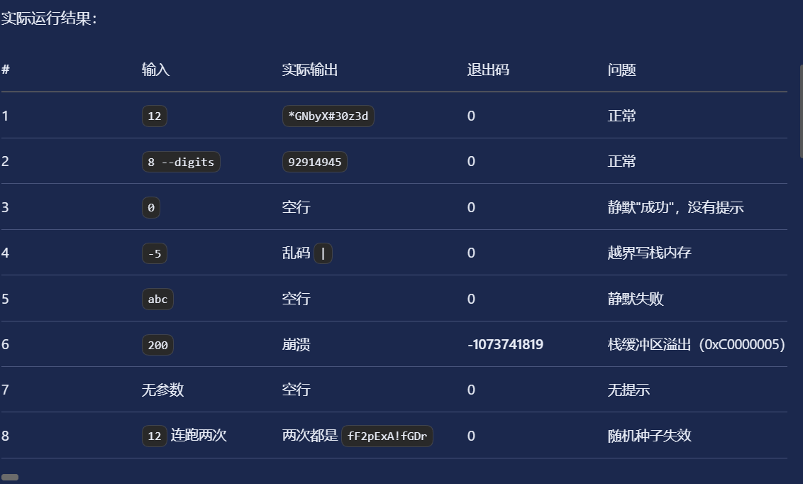
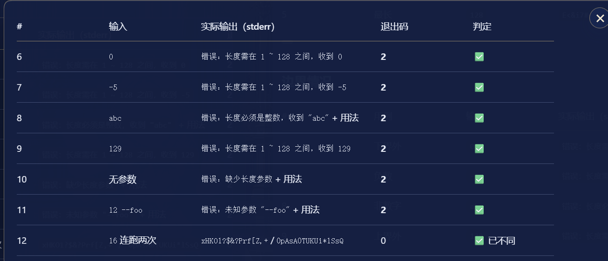

## 关于这个小项目的所有排错过程与解决方案  
### 第一版的排查  
-[第一次源代码](password-first.c)  
以下是第一次的测试结果  

### 第一版问题分析  
>要说明的是：我们的输入必须是int型的，>1&&<=128
>
首先先看第一个问题  

1.**静默失败**  
因为历史上 atoi("abc") 会静默返回 0，程序就把“非法输入”当成了“长度 0”，输出一个空行还返回成功。无法区分用户输入了“0”还是“abc”  

2.**负数导致越界写**  
先看着一段代码  
for (i = 0; i < len; i++) { buf[i] = ...; }   /* len = -5，循环不执行 */  
buf[len] = '\0';                              /* 写 buf[-5]，踩坏栈上其它变量 */  
很明显，这里len不能小于0  

3.**没有检查 argc**  
int len = atoi(argv[1]);   /* argc == 1 时 argv[1] 是 NULL */  
atoi(NULL) 恰好返回 0，于是程序不崩但也没输出，问题被藏起来了。  

4.**缓冲区与上限不匹配**
char buf[128];  
for (i = 0; i < len; i++) buf[i] = ...;   /* len = 200 时写穿 128 字节 */  
很明显，len的最大长度是128，这里200明显越界了  

5.**种子精度只到秒**  
通常情况下，不可能有真正的随机数，这里是时间为基准的伪随机数。假如我的两次输入都在同一秒内输入，那么他俩产生的随机数就是一样的了  

###第二版的排查  
-[第二次源代码](password-second.c)  
以下是第二次的测试结果
  
这一次成功了，接下来我要借助deepseek来完成我代码修改的对比检查  
