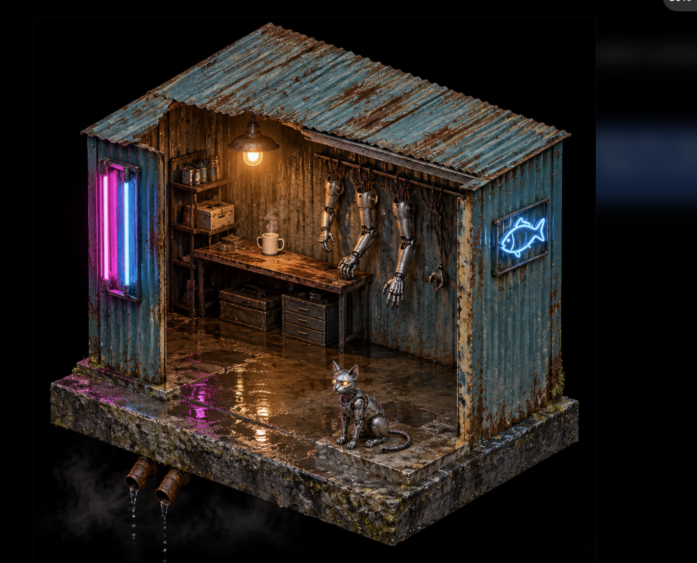

# 提示词工程实战：场景生成
## 说明  
我选择的是第二个场景  
**工具**  
deepseek chatgpt    
**基础提示词**  
帮我生成一个等轴测视角的赛博朋克风格微型场景描述，配套一份绘图提示词。场景主体是一个狭小的赛博格改装维修站，悬浮在废旧管道之上。包含闪烁的霓虹灯管、生锈的金属外壳、全息投影广告牌、机械义肢零件，以及脚边蹲着一只机械猫。背景是阴暗潮湿的雨夜，地面积水反光，未来科技感，高对比度，细节丰富。输出分成两部分：第一部分是场景文字描述，第二部分是可以直接给绘图模型使用的提示词（中英文皆可）。
## 第一轮  
我先把这个提示词扔给了AIGENT  
他给我的提示词是  
（英文）Isometric diorama of a cramped cybernetic augmentation repair kiosk suspended above a maze of abandoned industrial pipes, floating miniature scene, orthographic isometric view from 45 degrees above. Patchwork corrugated metal shell welded from scrap plates, rust bleeding through peeling teal paint, rivets, exposed cable bundles, sagging tarpaulin awning pinned by hydraulic clamps. Flickering magenta and cyan neon tubes, one broken tube spitting small blue electric arcs, faded hand-painted signage with missing strokes. A glitching holographic advertisement board hovers above the roof showing a swimming koi and a bowl of cheap noodles, scanlines and RGB split. Warm tungsten light inside: a workbench with a half-dismantled prosthetic leg, exposed circuit boards and ribbon cables, soldering iron, glass jars of cloudy liquid, racks of chrome hydraulic arms hanging on the wall, servo motors and coiled silicone wire on the floor. A small mechanical cat crouches at the doorstep, exposed servo spine, missing side panel revealing copper coils, cable tail curled, amber LED eyes. Rainy night, wet puddles mirroring neon, rain streaks, steam rising from pipe cracks, volumetric fog, no horizon, dark abyss below. High contrast rim lighting, deep blacks, teal-and-magenta palette with warm amber accents, macro miniature photography, tilt-shift depth of field, ultra detailed, cinematic, 8k  
（中文）等轴测视角的微型立体模型，一座狭小的赛博格改装维修站悬浮在废弃工业管道构成的迷宫之上，45度斜上方正交投影，悬浮微缩场景。波纹钢板层层叠焊的外壳，孔雀蓝油漆剥落露出锈迹，铆钉、外露线缆、用液压夹具固定的防雨油布。品红与青色霓虹灯管闪烁，其中一根破损并迸出蓝色小电弧，褪色的手写招牌缺笔画。屋顶上方悬着一块故障的全息广告牌，画面是游动的锦鲤和一碗廉价拉面，带扫描线与RGB色散。屋内暖色钨丝灯：工作台上摊着拆到一半的机械义肢、裸露电路板与排线、电烙铁、装着浑浊液体的玻璃罐，墙上挂着一排铬合金液压机械臂，地上散落伺服电机与成卷硅胶线。门口蹲着一只小型机械猫，外露伺服脊椎，侧面缺盖板露出铜线圈，线缆尾巴盘起，琥珀色LED眼睛。雨夜，积水倒映霓虹，雨丝、管道裂缝冒出的蒸汽、体积雾，没有地平线，下方是黑暗深渊。高对比度轮廓光，深黑阴影，青品红主调配暖琥珀点缀，微缩模型摄影，移轴景深，超精细，电影感，8K  

### 第一轮总结  
我感觉这一版的问题十分明显，我读不懂他在做什么，例如“褪色的手写招牌缺笔画”，这种词语很难让人理解，鉴于此，我打算让他做一个语法上修改，然后为了保证效果，我打算让他用英文输出，用中文的歧义太多  

## 第二轮  
基于第一轮出现的问题，我再一次对deepseek做出了调整  
### 第二次输出
Isometric scale model diorama, 1:24 handcrafted miniature, product photography on a seamless black background, entire set centered in frame, 30 degree elevation, orthographic, no perspective distortion.

A cramped cybernetic body-shop kiosk: welded corrugated steel shell, peeling teal paint over rust, rivets, hanging cables, tarpaulin awning clamped with hydraulics. Magenta and cyan neon sign on the left, one tube flickering; a tilted floating holographic billboard upper right showing a swimming koi, scanlines and slight chromatic aberration. Warm tungsten key light from inside lighting a workbench with a half-dismantled prosthetic limb and exposed circuit boards; three chrome hydraulic arms racked on the back wall. A small mechanical cat crouched left of the doorway, about one tenth of the frame width, exposed servo spine and copper coils, cable tail, amber glowing eyes.  

Wet platform mirroring neon, light rain, low steam from pipe cracks only along the bottom edge. Deep black background, hard rim light, cyan and magenta with amber accents, high contrast, distinct materials: rust, oil film, wet chrome, matte silicone, hand-painted resin.  

等轴测微缩模型，1:24 手作场景模型摄影，整块场景居中，纯黑无缝背景，30度仰角俯视，正交投影，无透视变形。

主体：一间拥挤的义体维修棚，波纹钢板焊接外壳，孔雀蓝漆剥落露锈，铆钉、垂落线缆、液压夹固定的油布雨棚。
左侧品红与青色霓虹招牌，其中一根闪烁；右上方一块倾斜悬浮的半透明全息广告牌，显示一条游动的锦鲤，带扫描线与轻微色散。
屋内一盏暖钨丝灯为主光，照亮工作台上拆解到一半的机械义肢与裸露电路板；后墙挂三条铬合金机械臂。
门口左侧蹲一只小机械猫，约占画面宽度十分之一，外露伺服脊椎与铜线圈，尾巴盘成线缆，双眼发琥珀光。

环境：地面积水镜面反射霓虹，细雨，管道裂缝的低处蒸汽仅出现在画面下缘。
深黑背景，硬边轮廓光，青与品红为主、琥珀作点缀，高对比，材质分明：锈、油膜、湿铬、哑光硅胶、树脂手涂漆面。  

### 第二轮总结  
这是第二版，很明显，他的文字更加简洁了，并且去掉了难懂的句子，但是，正因为变简单了，我感觉细节的描述并不清晰，反而漏出一种物体很模糊的感觉，并且呢，我感觉色调跟我想的有点偏差，灯是黄色的光，建筑却以铁这种颜色为主，反而有点不好看了  

## 第三轮  
基于第一轮和第二轮的缺陷，我又开始了第三轮的整改
### 第三次输出  
Isometric scale model diorama, 1:24 handcrafted set, seamless black background, 30 degree elevation, parallel lines stay parallel, entire set centered, cut-away base edge with exposed resin cross-section at the lower left corner.

A body-shop kiosk with the roof and front wall cut away dollhouse-style, shutter door facing the lower left toward camera. Welded corrugated steel, peeling teal paint over rust. A single warm tungsten lamp inside is the brightest point in frame, lighting a half-dismantled prosthetic limb on the bench and a steaming cup at its edge; three chrome hydraulic arms racked on the back wall. Magenta and cyan neon sign on the left, glow confined to the tubes; a tilted translucent holographic billboard upper right showing a swimming koi. A mechanical cat sits left of the doorway, body length one third of the door width, upright, head turned to camera, amber eyes lit but not blooming.

Below: sheared pipe stubs, hanging cables, dripping water fading fast into pure black. Puddles mirror broken neon lines and the cat's silhouette. Thin low steam only along the bottom edge. Hard rim light, the warm light forms an isolated pool separated from the cool tones by shadow. Rust, oil film, wet chrome, matte silicone, hand-painted highlights. Macro lens, f/11, sharp throughout.  
等轴测微缩模型，1:24 手作场景，纯黑无缝背景，30度仰角，平行线保持平行，整块场景居中，左下角露出底座剖面与树脂断面。

主体：一间义体维修棚，屋顶与前墙作娃娃屋式剖开，卷帘门朝画面左下正对镜头。焊接波纹钢板，孔雀蓝漆剥落露锈。
门内一盏暖钨丝灯是画面最亮点，照亮工作台上拆到一半的机械义肢，台边一只冒热气的杯子；后墙三条铬合金机械臂。
左侧品红与青色霓虹招牌，光晕只落在灯管周围；右上方倾斜悬浮一块半透明全息牌，显示游动的锦鲤。
门口左侧蹲一只机械猫，体长约门宽三分之一，坐姿端正，头转向镜头，双眼琥珀发光但不溢光。

下缘：剖断的管道、垂落线缆、向下滴的水，迅速沉入纯黑。地面积水映出霓虹的断续亮线与猫的轮廓。低处薄蒸汽只在下缘。
硬边轮廓光，暖光形成孤立光池，与冷色之间留暗部；锈、油膜、湿铬、哑光硅胶、手涂高光分明。微距镜头，f/11，全场清晰。  

### 第三轮总结  
我感觉这一版给的还送，但是细节还是处理的不太好，我打算先生成图片看一下效果  
  

感觉还行吧。
