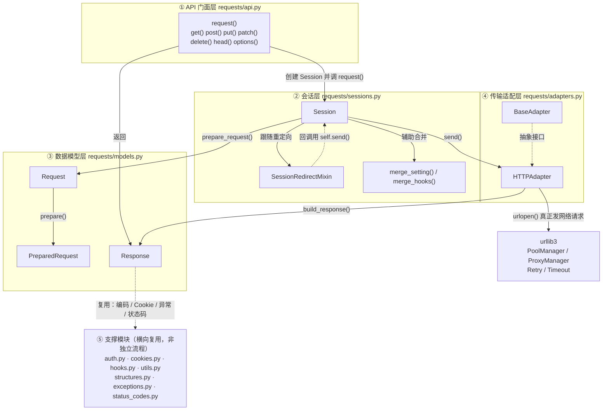
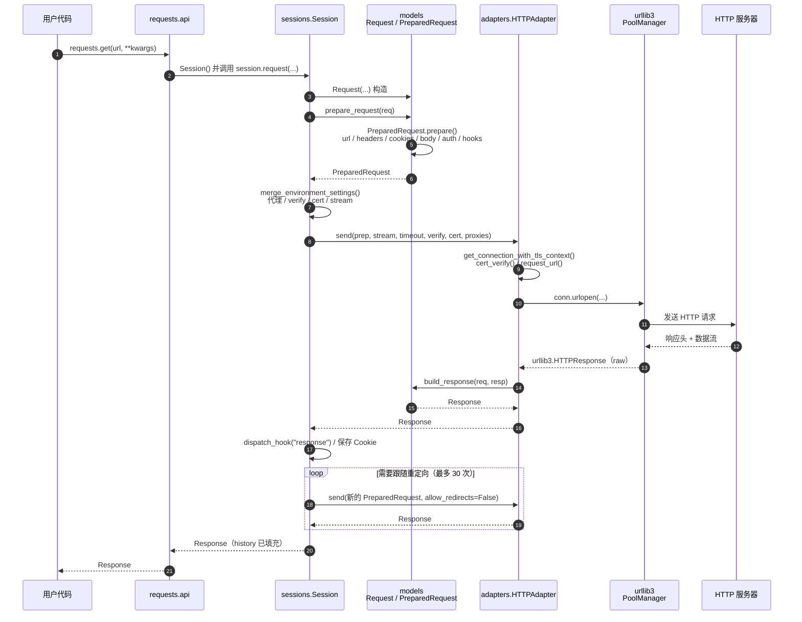
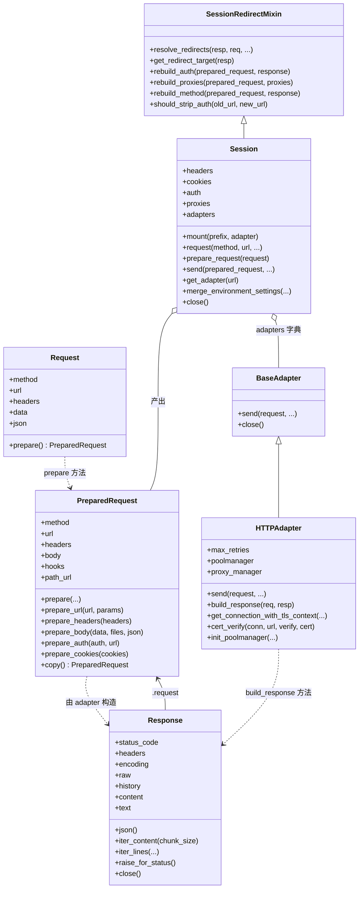

# psf/requests 核心模块调用关系与函数流程图

> 依据仓库 `psf/requests`（默认分支 `main`，源码目录 `src/requests/`）的真实代码绘制。
> 关键文件：`api.py`、`sessions.py`、`models.py`、`adapters.py`，辅以 `auth.py`、`cookies.py`、`hooks.py`、`utils.py`、`structures.py`、`exceptions.py`、`status_codes.py`。

---

## 一、模块依赖关系（分层视图）

`requests` 是「门面 → 会话 → 模型 → 适配器 → urllib3」的严格分层，下层不反向依赖上层。

> 为保持可读性，⑤ 支撑模块不画横向连线；实际复用关系是：`sessions` 用 cookie/hook/utils，`models` 用 auth/cookie/hook/utils/structures，`adapters` 用 auth/cookie/utils/structures，三层都只依赖 `exceptions` 而不反向被依赖。

**要点**

- `api.py` 里的 `request()` 每次都会 `with Session() as session:` —— 一次性请求和 `Session` 会话请求走的是同一条链路，区别只在连接池 / Cookie 是否复用。
- `adapters.py` 是唯一「真正碰到网络」的地方，其余模块只做数据加工；换传输实现（如自定义 `BaseAdapter`）不需要动上层。
- `models.py` 是纯数据与序列化逻辑，不依赖 `sessions`，避免循环导入。

---

## 二、一次 `requests.get()` 的完整函数调用流程

```mermaid
flowchart TD
    A["requests.get(url, params=...)"] --> B["api.request('get', url, params, **kwargs)"]
    B --> C["with Session() as session"]

    C --> D["Session.request(method, url, ...)"]
    D --> E["Request(method.upper(), url,<br/>headers, files, data, json,<br/>params, auth, cookies, hooks)"]
    E --> F["Session.prepare_request(req)"]

    F --> F1["merge_setting(headers / params / auth)<br/>merge_hooks(request.hooks, session.hooks)<br/>merge_cookies(session.cookies, request.cookies)<br/>get_netrc_auth(url) 环境认证"]
    F1 --> G["PreparedRequest.prepare(...)"]

    G --> G1["prepare_method()<br/>→ prepare_url()（IDNA / requote_uri / params 编码）<br/>→ prepare_headers()<br/>→ prepare_cookies()（get_cookie_header）<br/>→ prepare_body()（_encode_params / _encode_files / Content-Length）<br/>→ prepare_auth()（HTTPBasicAuth 或自定义 AuthBase）<br/>→ prepare_hooks()"]

    G1 --> H["Session.merge_environment_settings()<br/>get_environ_proxies / REQUESTS_CA_BUNDLE / merge_setting"]
    H --> I["Session.send(prep, timeout, allow_redirects, ...)"]

    I --> I1["resolve_proxies() + get_adapter(url)<br/>按 URL 前缀在 self.adapters 中查找"]
    I1 --> J["HTTPAdapter.send(request, stream, timeout, verify, cert, proxies)"]

    J --> J1["get_connection_with_tls_context()<br/>→ build_connection_pool_key_attributes()<br/>→ select_proxy() / proxy_manager_for()<br/>或 poolmanager.connection_from_host()"]
    J1 --> J2["cert_verify(conn, url, verify, cert)<br/>request_url() / add_headers()<br/>TimeoutSauce(connect, read)"]

    J2 --> K["conn.urlopen(method, url, body, headers,<br/>redirect=False, preload_content=False,<br/>retries=max_retries, timeout, chunked)"]
    K --> K1{"urllib3 抛异常？"}

    K1 -->|"MaxRetryError / SSLError /<br/>ProxyError / ClosedPoolError ..."| K2["转换为 requests.exceptions<br/>ConnectionError / SSLError /<br/>ConnectTimeout / ReadTimeout / ProxyError"]
    K2 --> X["向上抛出，交由调用者处理"]

    K1 -->|"成功"| L["HTTPAdapter.build_response(req, raw)"]
    L --> L1["Response()<br/>status_code / headers(CaseInsensitiveDict)<br/>encoding(get_encoding_from_headers)<br/>raw / url / reason<br/>extract_cookies_to_jar(response.cookies)"]

    L1 --> M["回到 Session.send：<br/>elapsed = clock() - start<br/>dispatch_hook('response', hooks, r)"]
    M --> M1["extract_cookies_to_jar(self.cookies, request, r.raw)"]

    M1 --> N{"allow_redirects 且 r.is_redirect？"}
    N -->|"是"| O["resolve_redirects(r, request)<br/>copy PreparedRequest → 改 url / method<br/>purge Content-* → rebuild_auth<br/>rebuild_proxies → self.send(..., allow_redirects=False)"]
    O -->|"递归/循环，最多 max_redirects=30 次"| I
    N -->|"否"| P{"stream == False？"}

    P -->|"是"| Q["r.content<br/>→ iter_content(CONTENT_CHUNK_SIZE)<br/>→ raw.stream(decode_content=True)"]
    P -->|"否"| R["立即返回，由调用者用<br/>iter_content() / iter_lines() 消费"]

    Q --> S["返回 Response 对象（含 status_code / headers / history）"]
    R --> S
```

---

## 三、时序图（一次请求的参与者交互）

---

## 四、核心对象的类关系（附加）

---

## 五、关键函数速查表

| 层 | 位置 | 函数 / 类 | 职责 |
|---|---|---|---|
| 门面 | `api.py` | `request()` | 开一个 `Session` 并转调 `session.request()`；`get/post/...` 都只是包一层 |
| 会话 | `sessions.py` | `Session.request()` | 组装 `Request`、调用准备与发送，是「一站式」入口 |
| 会话 | `sessions.py` | `Session.prepare_request()` | 合并 session 与 request 的设置（headers/params/auth/hooks/cookies），产出 `PreparedRequest` |
| 会话 | `sessions.py` | `merge_environment_settings()` | 读取环境变量代理、`REQUESTS_CA_BUNDLE`，与显式参数合并 |
| 会话 | `sessions.py` | `Session.send()` | 选 adapter、计时、跑 response hook、存 Cookie、处理重定向、按 `stream` 决定是否预读内容 |
| 会话 | `sessions.py` | `resolve_redirects()` | 生成器：复制请求、按状态码改方法、清 Content-*、重算 auth/proxy，递归 `send()` |
| 会话 | `sessions.py` | `Session.get_adapter()` | 按 URL 前缀（`https://`、`http://`）匹配 adapter，找不到抛 `InvalidSchema` |
| 模型 | `models.py` | `Request.prepare()` | 创建 `PreparedRequest` 并调用其 `prepare()` |
| 模型 | `models.py` | `PreparedRequest.prepare()` | 串起 method→url→headers→cookies→body→auth→hooks 七步准备 |
| 模型 | `models.py` | `prepare_url()` | IDNA 编码、`requote_uri`、拼接 params |
| 模型 | `models.py` | `prepare_body()` | JSON / 表单 / multipart 编码，处理流式 body 与 `Content-Length` |
| 模型 | `models.py` | `prepare_auth()` | 元组走 `HTTPBasicAuth`，否则调用用户 `AuthBase.__call__` |
| 模型 | `models.py` | `Response.content / text / json() / iter_content()` | 延迟读取与解码；`json()` 先用 `guess_json_utf` 猜 UTF 编码 |
| 适配 | `adapters.py` | `HTTPAdapter.send()` | 拿连接、校验证书、算 URL、构造超时、`urlopen()`、异常翻译、`build_response()` |
| 适配 | `adapters.py` | `get_connection_with_tls_context()` | 新 API（`get_connection()` 已弃用）；按 host/port/证书参数取连接池 |
| 适配 | `adapters.py` | `build_response()` | 把 urllib3 响应包成 `Response`，设置 encoding、cookies、`request`、`connection` |
| 支撑 | `cookies.py` | `extract_cookies_to_jar()` | 从 `raw._original_response` 抽取 `Set-Cookie` |
| 支撑 | `hooks.py` | `dispatch_hook()` | 依次调用 `response` 事件上的所有钩子 |
| 支撑 | `utils.py` | `resolve_proxies()` | 结合环境变量与 `NO_PROXY` 计算最终代理 |

---

## 六、读图结论

1. **两段式**：`prepare`（纯内存加工，可用 `Request().prepare()` 单独测试）与 `send`（碰网络）彻底分离，这是 requests 可测试性的来源。
2. **可插拔**：`Session.adapters` 是按前缀排序的字典，`mount()` 用「前缀长度降序」重排，因此 `https://example.com` 能覆盖 `https://`。
3. **重定向是递归**：`resolve_redirects()` 内部再调 `self.send(..., allow_redirects=False)`，因此每次跳转都会重新走 adapter，但**不会**重新走 `prepare_request`，靠 `PreparedRequest.copy()` 复用。
4. **异常翻译边界**：只有 `HTTPAdapter.send()` 把 urllib3 异常转成 `requests.exceptions`，上层拿到的始终是 requests 自己的异常体系。
5. **内容延迟消费**：`preload_content=False` + `stream` 控制，`stream=False` 时 `Session.send()` 末尾用 `r.content` 强制读完；`stream=True` 则由调用者 `iter_content()`。
